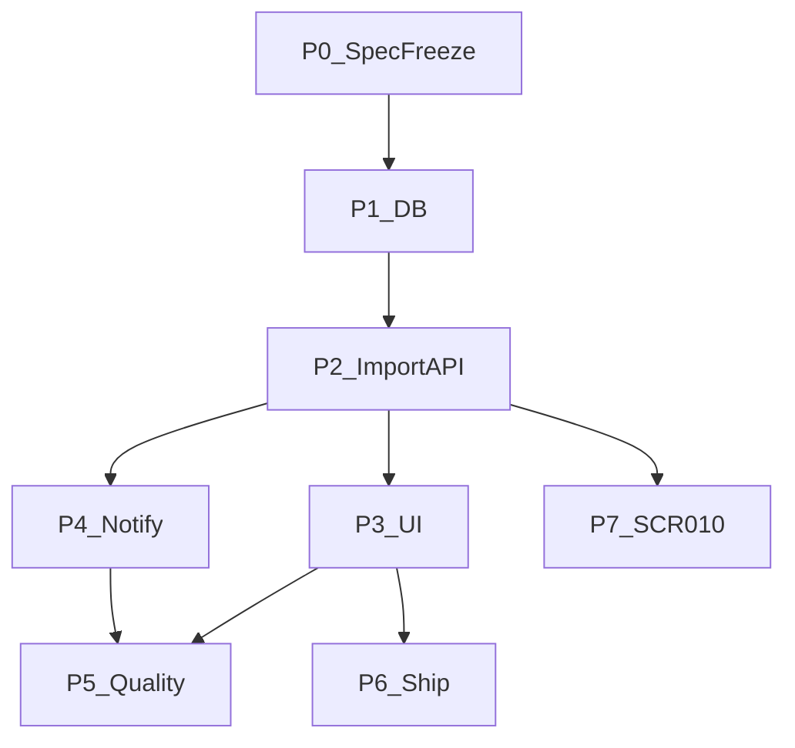

# 再開向けロードマップ（粗粒度）

| 項目 | 内容 |
|------|------|
| 作成日 | 2026-11-22 |
| 状態 | proposal（レビュー用） |
| 目的 | 最新仕様と現状実装のギャップを踏まえ、工程順・完了条件を共有する |
| 詳細計画 | 各工程を着手するとき `create-dev-plan` でコミット単位の計画書を切る |

仕様の正本は `docs/`。本ファイルは「どの順で・何が終われば次に進むか」の地図。

---

## 0. 現状サマリ

### すでに揃っているもの（現行MVP）

- 認証（Supabase Auth）
- 楽天CSV前提の単一ファイル取込・ルール/AI分類・明細一覧・仕分け・グラフ
- カテゴリ／ルール／固定費／手動支払いのCRUD画面・API
- 開発起動（`scripts/dev.sh`）

### 仕様は更新済み・実装が未着手（今回の主ギャップ）

- `card_issuers` / `csv_import_profiles`、`statements.card_issuer_id`
- プロファイル駆動の汎用CSVエンジン、`detect-issuer`、複数UP、`upload-status`
- issuer CRUD API、画面の取込バッジ／フィルタ／複数CSV確認UX
- リマインド（LINE・未取込issuer判定）

### 以前からの未了（並行 or 後続）

- LINEアップロード完了通知、Supabase Storage、集計への固定費・手動反映
- 仕分け時のルール追加提案、PWA/デプロイ、SCR-010画面（低優先）

### 重要メモ

- **要件・DB・API・画面の「文書」は、2カード＋プロファイル方針までほぼ反映済み。**
- したがって再開の第1工程は「ゼロから要件定義」ではなく、**文書の凍結確認＋未決の閉じ込み**が中心。
- 現状DBの `UNIQUE(year, month)` のままでは同月に楽天＋Amexを持てない。デュアルカード実装のブロッカー。

```text
いま:   楽天固定パーサ → Statement(year,month) → UI
目標:   複数CSV → 判定確認 → プロファイルエンジン → Statement(year,month,issuer) → バッジ/リマインド
```

---

## 1. 推奨する工程順

| # | 工程 | 主レイヤ | create-dev-plan の切り方（例） |
|---|------|----------|-------------------------------|
| P0 | 仕様凍結・未決クローズ | 要件／DB／API／画面の確認 | （小さければ計画書不要。未決だけ潰す） |
| P1 | DB・モデル基盤 | DB設計の実装 | `PLAN-...-issuers-schema.md` |
| P2 | 取込エンジン・明細API | API設計の実装 | `PLAN-...-csv-engine-upload.md` |
| P3 | デュアルカードUI | 画面設計の実装 | `PLAN-...-dual-card-ui.md` |
| P4 | 通知・リマインド | API＋運用 | `PLAN-...-line-remind.md` |
| P5 | 運用品質（集計・仕分け・Storage） | API／画面 | 機能ごとに分割可 |
| P6 | 公開準備（PWA・デプロイ） | インフラ | `PLAN-...-pwa-deploy.md` |
| P7 | 取込プロファイル管理画面 | 画面（低優先） | `PLAN-...-scr010.md` |

依存のイメージ:



---

## 2. 各工程の内容と完了条件

### P0 仕様凍結・未決クローズ

**確定済み（2026-11-22）**

- [x] 実装範囲: デュアルカード＋プロファイル駆動（会社専用パーサは増やさない）
- [x] Amexサンプル: `sample/amex/*.csv`（cp932）。ヘッダは `ご利用日,データ処理日,ご利用内容,カード会員様名,会員番号 #,金額,...`
- [x] 楽天サンプル: `sample/rakuten/*.csv`。ヘッダは `利用日,利用店名・商品名,利用者,利用金額,...`
- [x] リマインド日: **issuer ごとに DB で変更可**。初期値 **楽天=毎月23日 / Amex=毎月4日**（`remind_day_of_month`）
- [x] インフラ: 本番は Supabase 維持

**LINE 方針（確定）**

- [x] 宛先: **夫婦＋ボットのグループ1つ**へ Push（個別IDは使わない）
- [x] LINE公式アカウント（Messaging API）は必要。**コミュニケーションプラン（月額0円・月200通）で足りる想定**
- [ ] P4着手時: 公式アカウント作成、グループ招待、グループID取得、チャネルアクセストークンを環境変数へ

**P0では保留（P4着手前で可）**

- [ ] 再通知間隔（例: 初回日の +3 日）
- [ ] Amex 名義の正式マップ（サンプルでは `SOTA NAKAJIMA`→夫 / `SEIRA NAKAJIMA`→妻 を仮置き可）

**完了条件（P0）**

- [x] 上記の確定事項が docs（要件・DB・API・本ロードマップ）に反映されている
- [x] P1（DB実装）に進んでよい状態

**create-dev-plan:** P0自体は不要。次は P1 向けに作成する。

---

### P1 DB・モデル基盤

**何をするか**

- `card_issuers` / `csv_import_profiles` 追加
- `statements.card_issuer_id` 化、`UNIQUE(year, month, card_issuer_id)`
- SQLAlchemyモデル・Alembicマイグレーション
- 楽天（＋可能ならAmex）のシード

**完了条件**

- [ ] マイグレーション適用後、同月に issuer 違いの `statements` を2件入れられる
- [ ] 既存データの移行方針が実行済み（既存行に既定issuer付与など）
- [ ] モデル／シードが `docs/db/db_design.md` と矛盾しない

**create-dev-plan:** DBマイグレーション → モデル → シード、程度に Step 分割。

---

### P2 取込エンジン・明細API

**何をするか**

- 汎用CSVエンジン（encoding / header_signature / column_mapping / transforms / skip_rules）
- `POST /statements/detect-issuer`
- 複数ファイルupload・issuer単位置換・`results[]`
- `GET /statements/upload-status`
- 一覧・集計への issuer フィルタ／レスポンス項目
- `/card-issuers`・`/csv-import-profiles` の CRUD API（画面は後回し）

**完了条件**

- [x] 楽天CSVをプロファイル経由で取込できる（ハードコード列依存をやめている）
- [x] （サンプルがあれば）Amexも同じエンジンで取込できる
- [x] detect → 確認用コード指定 → upload のAPI一連が通る
- [x] upload-status が `include_in_reminder` 対象の missing を返す
- [x] API仕様書の該当節と実装が一致（または docs を実装に合わせて即時整合）

**create-dev-plan:** エンジン＋テスト → detect → upload書き換え → status/list → issuer CRUD、など。

---

### P3 デュアルカードUI

**何をするか**

- SCR-005: 複数CSV、自動判定結果の確認・修正、PDF選択肢削除
- SCR-002 / SCR-004: 取込状況バッジ、issuerフィルタ／表示
- APIクライアント更新

**完了条件**

- [ ] 同じ月に楽天＋AmexをUIから連続取込し、一覧で両方見える
- [ ] 未取込バッジが upload-status と一致する
- [ ] `docs/screens/screen_specification.md` の該当SCRと大きく矛盾しない

**create-dev-plan:** APIクライアント → Upload → List/Badge → Analytics、など。

---

### P4 通知・リマインド

**何をするか**

- アップロード完了の妻向けLINE
- `POST /notify/remind`（未取込issuerのみ）＋ cron 想定の秘密鍵
- （任意）`.ics`

**完了条件**

- [ ] 設定日想定の remind 呼び出しで、missing があるときだけ通知される（またはドライランで検証）
- [ ] アップロード完了通知が動作する（または明示的に「トークン未設定時スキップ」がログで分かる）
- [ ] 運用手順（cron / 環境変数）が README か memo に残っている

**依存:** P2の upload-status（および issuer マスタ）があると実装が素直。

---

### P5 運用品質（集計・仕分け・Storage）

**何をするか（優先度順の目安）**

1. 集計APIへの手動支払い・固定費反映
2. SCR-003 ルール追加提案
3. Supabase Storage への原本保存
4. （バックログ）再UP時の手動仕分け保持

**完了条件（機能ごと）**

- [ ] 集計: カード明細＋手動（＋仕様どおり固定費）が月次合計に含まれる
- [ ] 仕分け: ルール追加チェックからルールが作れる
- [ ] Storage: `file_url` が実URL（またはバケットパス）になる

**create-dev-plan:** 機能単位で別計画書に分割推奨。

---

### P6 公開準備（PWA・デプロイ）

**何をするか**

- `frontend/web` / PWA
- Render（または選定ホスト）へのAPI・フロント配置
- 本番Supabase・環境変数・最小動作確認

**完了条件**

- [ ] 家族がブラウザからログイン〜取込〜閲覧できるURLがある
- [ ] 秘密情報がリポジトリに含まれない
- [ ] 起動／デプロイ手順が README に追記されている

---

### P7 取込プロファイル管理画面（SCR-010）※低優先

**何をするか**

- issuer / プロファイルのCRUD UI（APIはP2で用意済み想定）

**完了条件**

- [ ] 新カード用のマッピングを、ソース修正なしで画面（または当面API）から追加できる
- [ ] 追加後、SCR-005の判定・取込でそのissuerが使える

---

## 3. 「要件→DB→画面→API」との対応

古典的なウォーターフォールの文書工程は、**今回はほぼP0で完了扱い**にできる。

| 古典的工程 | 本ロードマップでの位置 |
|------------|------------------------|
| 要件定義 | 文書更新済み → P0で凍結 |
| DB設計 | 文書更新済み → P1で実装 |
| API設計 | 文書更新済み → P2で実装 |
| 画面設計 | 文書更新済み → P3（＋P7）で実装 |
| 通知・運用設計 | 文書に方針あり → P4で実装 |
| インフラ | 方針はSupabase維持 → P6 |

新機能を足すときは、毎回「小さな要件/DB/API/画面のdocs更新 Step」を create-dev-plan の先頭に置く（プロジェクトスキルのルールどおり）。

---

## 4. 当面の推奨フォーカス

家族の日常利用を最短で近づけるなら:

1. **P0**（Amexサンプルの扱いだけでも決める）
2. **P1 → P2 → P3**（デュアルカード取込の縦通し）
3. **P4**（忘れ防止）
4. 必要に応じて P5 → P6。P7は余裕ができてから

---

## 5. 次アクション

1. 本ロードマップの工程分割・優先順をレビューする
2. 合意した最初の工程（推奨: P1）について `create-dev-plan` で詳細計画書を作成する
3. `execute-dev-plan-step` で Step 実行
