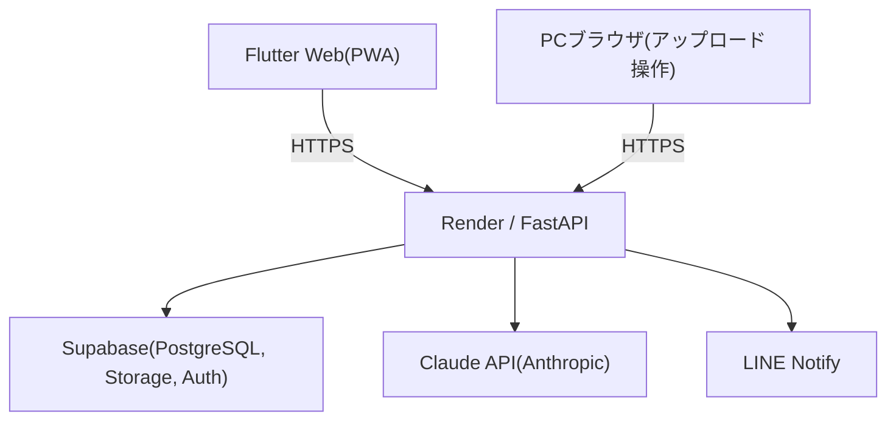

# 家族家計管理アプリ 要件定義書

## 目次

1. [文書情報](#1-文書情報)
2. [プロジェクト概要](#2-プロジェクト概要)
3. [背景と課題](#3-背景と課題)
4. [機能要件](#4-機能要件)
5. [非機能要件](#5-非機能要件)
6. [技術スタック](#6-技術スタック)
7. [システム構成図](#7-システム構成図)
8. [開発フェーズ](#8-開発フェーズ)
9. [未決事項](#9-未決事項)

## 1. 文書情報

| 項目 | 内容 |
|------|------|
| 文書名 | 要件定義書 |
| 対象システム | 家族家計管理アプリ（仮称） |
| 版数 | 0.1 |
| ステータス | 叩き台 |

## 2. プロジェクト概要

| 項目 | 内容 |
|------|------|
| 対象ユーザー | 家族2名（夫・妻） |
| 主要プラットフォーム | PWA（PC・スマホ対応） |
| 開発目的 | 家計管理の見える化と作業負荷の削減 |
| 公開範囲 | 家族内のみ |
| 将来拡張 | スケジュール共有など家族向け機能へ拡張 |

## 3. 背景と課題

- 楽天家族カードの明細閲覧は本会員（夫）に限定される。
- 家計管理担当（妻）が明細確認するには、都度共有が必要で手間が大きい。
- タイムリーな家計把握が難しく、カテゴリ分けも毎月手作業になっている。

## 4. 機能要件

### 4.1 明細アップロード

| 機能 | 詳細 | 優先度 |
|------|------|--------|
| 手動アップロード | CSV/PDF明細をアップロード | 高 |
| ファイル形式対応 | 楽天カードCSV・PDF対応 | 高 |
| アップロード完了通知 | 完了時に妻へLINE通知 | 高 |
| 明細確定リマインド | 毎月6日頃に夫へLINE通知 | 中 |

補足:
- 楽天カードサイトの自動スクレイピングは規約リスクのため非採用。

### 4.2 明細閲覧

| 機能 | 詳細 | 優先度 |
|------|------|--------|
| 明細一覧表示 | 日付・店名・金額・名義人を表示 | 高 |
| 月次切り替え | 月を指定して過去明細参照 | 高 |
| フィルター | カテゴリ・名義人・未分類で絞り込み | 中 |
| 月次集計サマリー | カテゴリ別・名義人別合計を可視化 | 中 |
| 前月比表示 | カテゴリごとの差分表示 | 低 |

### 4.3 明細仕分け

| 機能 | 詳細 | 優先度 |
|------|------|--------|
| カテゴリマスター管理 | カテゴリのCRUD | 高 |
| ルールベース自動分類 | 店名パターンによる自動分類 | 高 |
| AI自動分類 | ルール外データをClaude APIで分類 | 高 |
| 手動上書き | 自動分類結果を手動修正可能 | 高 |
| 分類ルール管理 | ルールのCRUD | 高 |
| ルール追加提案 | 手動修正時にルール追加を提案 | 中 |

### 4.4 手動支払い・固定費

| 機能 | 詳細 | 優先度 |
|------|------|--------|
| 手動支払い登録 | カード明細外（現金等）を登録 | 中 |
| 固定費マスター管理 | Netflix・家賃等を管理 | 中 |
| 固定費の集計反映 | 月次集計へ動的反映 | 中 |

### 4.5 通知

| 機能 | 詳細 | 優先度 |
|------|------|--------|
| アップロード完了通知 | 夫のアップロード完了を妻へ通知 | 高 |
| 明細確定リマインド | 毎月6日頃、夫へ通知 | 中 |
| 予算超過アラート | 将来的に超過カテゴリを通知 | 低 |

### 4.6 認証

| 機能 | 詳細 | 優先度 |
|------|------|--------|
| メール認証 | Supabase Auth（メール+パスワード） | 高 |
| ユーザー管理 | 夫・妻の2アカウント運用 | 高 |

#### 環境別の認証方針

- 本番・開発ともに Supabase Auth を使い、認証コードパスを完全に1本化する。
- 環境ごとに別の Supabase プロジェクト（dev / prod）を用意し、`SUPABASE_JWT_SECRET` を切り替える。
- バックエンドは access token (JWT, HS256) を `SUPABASE_JWT_SECRET` でローカル検証し、毎リクエストでの Supabase API 呼び出しは行わない。
- 検証後の `sub`（Auth の UUID）で `users` テーブルを引き、未登録ユーザーは 403 を返す。
- ユニットテストでは FastAPI の `app.dependency_overrides[get_current_user]` で固定ユーザーを注入し、JWT 発行や Supabase 接続を介さず認証層を通す。

### 4.7 将来機能

| 機能 | 詳細 | 優先度 |
|------|------|--------|
| 明細ダウンロード | 原本ファイルを取得 | 低 |
| スケジュール共有 | 家族カレンダー共有 | 将来 |

## 5. 非機能要件

| 区分 | 要件 |
|------|------|
| セキュリティ | HTTPS必須、機密情報は環境変数管理 |
| 認証 | 未ログイン時アクセス不可 |
| 可用性 | 家族内利用のため高可用性は必須でない（Renderスリープ許容） |
| 拡張性 | バックエンドを機能単位でモジュール分割 |
| コスト | 初期は無料枠中心、AI利用は従量課金 |
| バックアップ | Supabaseの自動バックアップ利用 |
| 対応デバイス | PC/iPhone/Android（PWA） |

## 6. 技術スタック

| レイヤー | 技術 | 選定理由 |
|----------|------|----------|
| フロントエンド | Flutter（Dart）Webビルド | iOS/Android/Webを1コードベースで運用しやすいため |
| 状態管理 | Riverpod | Flutterとの相性がよく、テストしやすいため |
| HTTPクライアント | Dio | インターセプターやエラーハンドリングを実装しやすいため |
| バックエンド | Python 3.11 + FastAPI | CSV/PDF処理やAI連携を実装しやすいため |
| ORM | SQLAlchemy | FastAPI構成で標準的に利用できるため |
| データベース | PostgreSQL（Supabase） | 無料枠があり、運用管理もしやすいため |
| ファイルストレージ | Supabase Storage | DB/認証と同一基盤で管理を統一できるため |
| 認証 | Supabase Auth | メール認証を短期間で構築できるため |
| AI分類 | Claude API（Anthropic） | 日本語店名の分類精度を期待できるため |
| 通知 | LINE Notify | 家族運用で導入コストが低いため |
| ホスティング | Render | GitHub連携による自動デプロイが容易なため |
| CI/CD | GitHub -> Render 自動デプロイ | push起点で反映でき、運用負荷を抑えられるため |

## 7. システム構成図

- クライアントはスマホ/PCのブラウザからPWAへアクセスする。
- APIサーバーはRender上のFastAPIで、明細取込・分類・集計・通知を担当する。
- データ永続化はSupabase（PostgreSQL/Storage/Auth）で統一する。
- ルールで分類できない明細はClaude APIで補完分類し、通知はLINE Notifyで配信する。

## 8. 開発フェーズ

| フェーズ | 内容 | 成果物 |
|----------|------|--------|
| Phase 1 | インフラ基盤構築 | FlutterからAPI呼び出し可能 |
| Phase 2 | 認証導入 | ログイン必須で利用可能 |
| Phase 3 | コア機能実装 | 明細アップロード・閲覧・手動仕分け |
| Phase 4 | AI分類・通知 | 自動分類とLINE通知 |
| Phase 5 | 可視化・固定費 | 日常運用可能レベルの機能 |
| Phase 6 | 将来機能 | スケジュール共有など拡張 |

## 9. 未決事項

- 明細確定リマインド日付の最終確定。
- LINE Notifyのトークン運用方針（個人/グループ）。
- AI分類の確信度しきい値最適化。
- Render有料移行の判断基準。
- 楽天カードCSVフォーマット実データ検証。
- 固定費と明細の重複計上防止ロジック詳細化。
