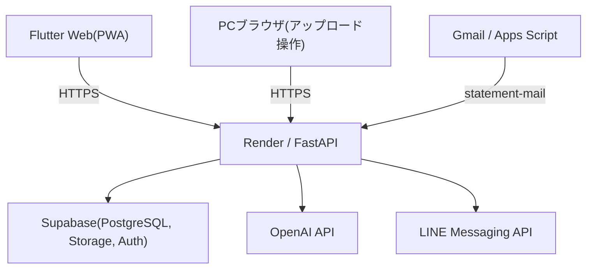

# 家族家計管理アプリ 要件定義書

## 目次

1. [文書情報](#1-文書情報)
2. [プロジェクト概要](#2-プロジェクト概要)
3. [背景と課題](#3-背景と課題)
4. [機能要件](#4-機能要件)
5. [非機能要件](#5-非機能要件)
6. [技術スタック](#6-技術スタック)
7. [システム構成図](#7-システム構成図)
8. [開発フェーズ](#8-開発フェーズ)
9. [未決事項](#9-未決事項)

## 1. 文書情報

| 項目 | 内容 |
|------|------|
| 文書名 | 要件定義書 |
| 対象システム | 家族家計管理アプリ（仮称） |
| 版数 | 0.2 |
| ステータス | 仕様見直し反映 |

## 2. プロジェクト概要

| 項目 | 内容 |
|------|------|
| 対象ユーザー | 家族2名（夫・妻） |
| 主要プラットフォーム | PWA（PC・スマホ対応） |
| 開発目的 | 家計管理の見える化と作業負荷の削減 |
| 公開範囲 | 家族内のみ |
| 支払手段 | 楽天カードおよび American Express（Amex）の2系統 |
| 将来拡張 | スケジュール共有など家族向け機能へ拡張 |

## 3. 背景と課題

- 家計のカード支払いは **楽天カード** と **American Express（Amex）** の2種類で行われている。
- 楽天家族カードの明細閲覧は本会員（夫）に限定される。Amex も原則ログイン権限のある会員が原本を取得する。
- 家計管理担当（妻）が明細確認するには、都度共有が必要で手間が大きい。
- タイムリーな家計把握が難しく、カテゴリ分けも毎月手作業になっている。
- カード会社の個人向け明細APIは提供されていないため、完全自動取込は現実的でない。手動CSV取込を主経路とし、作業の簡略化と忘れ防止で運用負荷を下げる。

## 4. 機能要件

### 4.1 明細アップロード

用語:

- **issuer（カード発行会社）**: 明細の出所となるカード会社を指す内部コード／マスタ。例: `rakuten`（楽天）、`amex`（Amex）。画面上は「楽天」「Amex」と表示する。同月に複数社分を区別し、取込状況・リマインドの単位にも使う。
- **共通モデル**: 取込後の明細行の共通形（利用日・店名・金額・名義人・issuer 等）。以降の分類・一覧・集計はすべてこの形だけを扱う。
- **CSV取込プロファイル**: 会社ごとの CSV 列対応・文字コード・スキップ規則などを DB に持つ設定。会社専用パーサをソースに増やさない。

| 機能 | 詳細 | 優先度 |
|------|------|--------|
| 手動アップロード | issuer ごとの CSV 明細をアップロード | 高 |
| プロファイル駆動の変換 | DB の取込プロファイルに従い CSV を共通モデルへ変換（汎用エンジン1本） | 高 |
| 初期対応 | 楽天・Amex のプロファイルをシード投入。PDF は低優先（将来） | 高 |
| 複数ファイル一括取込 | 複数 CSV を一度に選択して取込可能 | 高 |
| 発行会社の自動判定 | プロファイルのヘッダ指紋等で自動判定し、**画面で確認してから**取込 | 高 |
| 取込プロファイル管理API | プロファイルの CRUD（カード追加＝マッピング追加）。当面は API/SQL でメンテ | 高 |
| 取込プロファイル管理画面 | 上記の UI。カード追加のたびにソース修正しないための画面 | 低 |
| アップロード完了通知 | 取込成功時に LINE グループへ通知。詳細は `docs/notifications/line_notification.md` | 高 |
| 明細メール着信通知 | 明細案内メールの着信を Apps Script が API に伝え、未取込のときだけ受信メールとアップロード画面の URL を手順つきで LINE 通知する | 高 |
| アプリ内未完了表示 | 対象月の issuer ごとの取込済み／未取込をヘッダ等で表示 | 高 |

補足（変換方針）:

- 会社専用パーサクラスを増やす運用はしない。差分は DB の取込プロファイルで表現する。
- `custom_hook`（任意・低優先）: 列マッピングやスキップ規則だけでは表現しきれない特殊形式向けの逃げ道。プロファイルに「特別処理の名前」を任意で持てるようにしておくが、通常は未使用（NULL）。必要になるまで実装しなくてよい。

補足（自動取得について）:

- 楽天・日本 Amex とも、個人が発行できる公式の明細 API／OAuth アクセストークンは現状ない。
- スクレイピングは利用規約・Bot対策のリスクがあるため **非採用**。
- 利用通知メールのパースは欠損（サブスク・公共料金等）が多く、正本取込には不向き。
- マネーフォワード等の中間サービス経由は、自作アプリへの公式出口が個人用途では重いため当面対象外。将来再検討可。

再アップロード方針:

- 同一 `year` / `month` / issuer の再アップロードは、当該発行会社分を **置換**（既存行削除後に再登録）とする。
- 手動仕分けの保持は別バックログ（`memo/future_works.md`）とし、本要件の必須範囲外とする。

### 4.2 明細閲覧

| 機能 | 詳細 | 優先度 |
|------|------|--------|
| 明細一覧表示 | 日付・店名・金額・名義人・カード発行会社を表示 | 高 |
| 月次切り替え | 月を指定して過去明細参照 | 高 |
| フィルター | カテゴリ・名義人・カード発行会社・未分類で絞り込み | 中 |
| 月次集計サマリー | カテゴリ別・名義人別合計を可視化 | 中 |
| 前月比表示 | カテゴリごとの差分表示 | 低 |

### 4.3 明細仕分け

| 機能 | 詳細 | 優先度 |
|------|------|--------|
| カテゴリマスター管理 | カテゴリのCRUD | 高 |
| ルールベース自動分類 | 店名パターンによる自動分類 | 高 |
| AI自動分類 | ルール外データを OpenAI API で分類 | 高 |
| 手動上書き | 自動分類結果を手動修正可能 | 高 |
| 分類ルール管理 | ルールのCRUD | 高 |
| ルール追加提案 | 仕分け画面で、選んだカテゴリを次回取込のルールにする（下記） | 中 |

ルール追加提案は、仕分け画面（SCR-003）のチェックとダイアログで行う。チェックがオフのときは、その明細のカテゴリだけを手動修正として保存して画面を閉じる。オンのときは、支払い名と正規表現の有無を編集してから保存する。戻る、前後の空白を除いて空の支払い名、コンパイルできない正規表現では、明細もルールも保存しない。通ったあとは明細を先に保存し、続けてルールを 1 件作るか、同じパターンかつ同じ正規表現フラグの行をすべて更新する。優先度は保存時点の最大値 + 10 で、ルールが無ければ 10。追加したルールは次回の取込から効き、同じ月の他の明細は変えない。操作は画面仕様の SCR-003、拒否条件は API 仕様 §3.3、マッチ（オフは部分一致、オンは `re.search`、評価は priority 降順で同点は id 昇順）は API 仕様 §4。

### 4.4 手動支払い・固定費

| 機能 | 詳細 | 優先度 |
|------|------|--------|
| 手動支払い登録 | カード明細外（現金等）を登録 | 中 |
| 固定費マスター管理 | Netflix・家賃等を管理 | 中 |
| 固定費の集計反映 | 発行会社未指定の月次集計へ、対象月に有効な分を動的反映 | 中 |

手動支払いと固定費は発行会社を持たない。発行会社を指定しない月次集計（カテゴリ別・名義人別・月次推移）は、カード明細に、対象年月の手動支払いと、その月に有効な固定費を合算する。発行会社を指定した集計は、そのカードの明細だけとする。

固定費は、カード明細に載らない支払いとして登録する。明細に載っている支払いを固定費にも登録すると二重になる。自動での除外はしない。

### 4.5 通知

| 機能 | 詳細 | 優先度 |
|------|------|--------|
| アップロード完了通知 | 取込成功時に、夫婦＋ボットのグループへ通知 | 高 |
| 明細メール着信通知 | Gmail の明細案内をきっかけに、未取込の issuer だけ同じグループへ通知する。受信メールとアップロード画面の URL を手順つきで載せる | 高 |
| 予算超過アラート | 将来的に超過カテゴリを通知 | 低 |

詳細は `docs/notifications/line_notification.md`。毎月の固定日と `.ics` は使わない。`remind_day_of_month` 列は残すが、通知条件には使わない。

### 4.6 認証

| 機能 | 詳細 | 優先度 |
|------|------|--------|
| メール認証 | Supabase Auth（メール+パスワード） | 高 |
| ユーザー管理 | 夫・妻の2アカウント運用 | 高 |

#### 環境別の認証方針

- 本番・開発ともに Supabase Auth を使い、認証コードパスを完全に1本化する。
- 環境ごとに別の Supabase プロジェクト（dev / prod）を用意し、JWT 検証設定を切り替える。
- バックエンドは access token (JWT) をローカル検証し、毎リクエストでの Supabase API 呼び出しは行わない。
- 検証後の `sub`（Auth の UUID）で `users` テーブルを引き、未登録ユーザーは 403 を返す。
- ユニットテストでは FastAPI の `app.dependency_overrides[get_current_user]` で固定ユーザーを注入し、JWT 発行や Supabase 接続を介さず認証層を通す。

### 4.7 将来機能

| 機能 | 詳細 | 優先度 |
|------|------|--------|
| 明細ダウンロード | 原本ファイルを取得 | 低 |
| スケジュール共有 | 家族カレンダー共有 | 将来 |
| カード会社／中間サービス経由の自動取得 | 公式APIや認可済み連携が個人用途で現実化した時点で再検討 | 将来 |

## 5. 非機能要件

| 区分 | 要件 |
|------|------|
| セキュリティ | HTTPS必須、機密情報は環境変数管理 |
| 認証 | 未ログイン時アクセス不可 |
| 可用性 | 家族内利用のため高可用性は必須でない（Renderスリープ許容） |
| 拡張性 | バックエンドを機能単位でモジュール分割 |
| コスト | 無料枠〜低コストを優先（詳細は `memo/infra_cost_comparison.md`） |
| バックアップ | Supabaseの自動バックアップ利用 |
| 対応デバイス | PC/iPhone/Android（PWA） |

## 6. 技術スタック

| レイヤー | 技術 | 選定理由 |
|----------|------|----------|
| フロントエンド | Flutter（Dart）Webビルド | iOS/Android/Webを1コードベースで運用しやすいため |
| 状態管理 | Riverpod | Flutterとの相性がよく、テストしやすいため |
| HTTPクライアント | Dio | インターセプターやエラーハンドリングを実装しやすいため |
| バックエンド | Python 3.11 + FastAPI | CSV処理やAI連携を実装しやすいため |
| ORM | SQLAlchemy | FastAPI構成で標準的に利用できるため |
| データベース | PostgreSQL（Supabase） | 無料枠があり、運用管理もしやすいため |
| ファイルストレージ | Supabase Storage | DB/認証と同一基盤で管理を統一できるため |
| 認証 | Supabase Auth | メール認証を短期間で構築できるため |
| AI分類 | OpenAI API | 実装済み経路。店名からのカテゴリ推定に利用 |
| 通知 | LINE Messaging API | 家族運用で導入コストが低いため |
| ホスティング | Render | GitHub連携による自動デプロイが容易なため |
| CI/CD | GitHub -> Render 自動デプロイ | push起点で反映でき、運用負荷を抑えられるため |

インフラ方針:

- **本番はコスト優先で Supabase + Render を維持する。** AWS への載せ替えは本アプリの必須要件としない。
- AWS は学習用サンドボックス、または別自作アプリでの利用を想定する（比較は `memo/infra_cost_comparison.md`）。

## 7. システム構成図

- クライアントはスマホ/PCのブラウザからPWAへアクセスする。
- APIサーバーはRender上のFastAPIで、明細取込・分類・集計・通知を担当する。
- データ永続化はSupabase（PostgreSQL/Storage/Auth）で統一する。
- ルールで分類できない明細は OpenAI API で補完分類し、通知は LINE Messaging API で配信する。
- 明細案内メールは Gmail の Apps Script が検知し、未取込のときだけ API がグループへ LINE を送る。

## 8. 開発フェーズ

| フェーズ | 内容 | 成果物 |
|----------|------|--------|
| Phase 1 | インフラ基盤構築 | FlutterからAPI呼び出し可能 |
| Phase 2 | 認証導入 | ログイン必須で利用可能 |
| Phase 3 | コア機能実装 | 明細アップロード・閲覧・手動仕分け |
| Phase 4 | AI分類・通知 | 自動分類とLINE通知・リマインド |
| Phase 5 | 可視化・固定費・プロファイル駆動の多カード運用 | 日常運用可能レベルの機能 |
| Phase 6 | 将来機能 | 取込プロファイル管理画面・スケジュール共有など |

## 9. 未決事項

- LINE: 宛先は夫婦＋ボットのグループ1つ。きっかけは明細案内メール（`docs/notifications/line_notification.md`）。グループID・トークン取得は P4 着手時。
- Amex 明細案内メールの差出人・件名（P4 着手時に実メールで決める）。
- Amex 名義マップ（ローマ字氏名→夫/妻）の正式な対応表（サンプル上は `SOTA NAKAJIMA` / `SEIRA NAKAJIMA`）。
- AI分類の確信度しきい値最適化。
- Render有料移行の判断基準。
- ヘッダ指紋の衝突時の優先ルール詳細。
